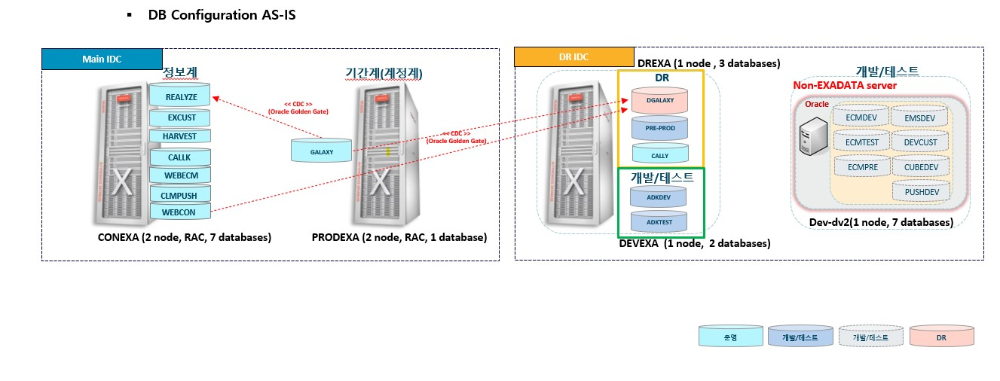
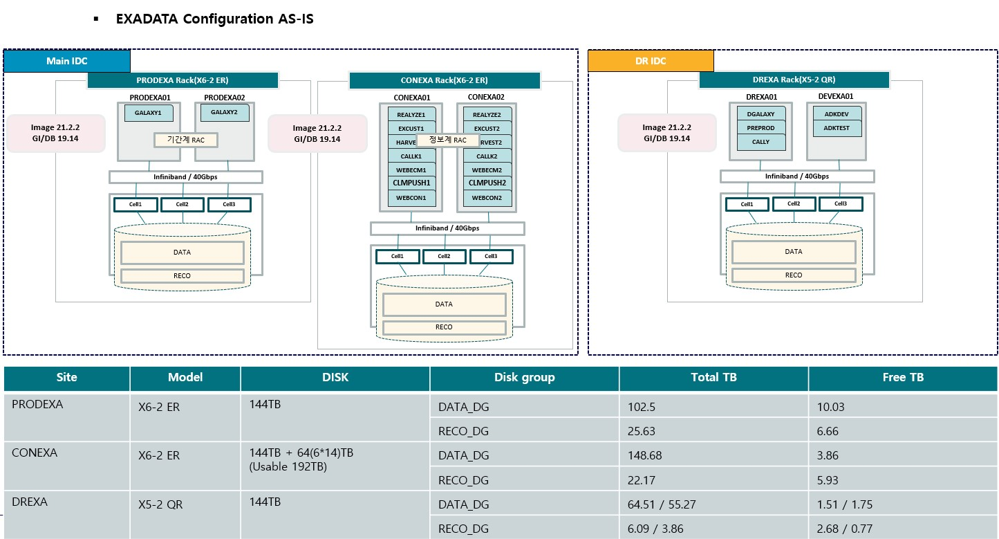
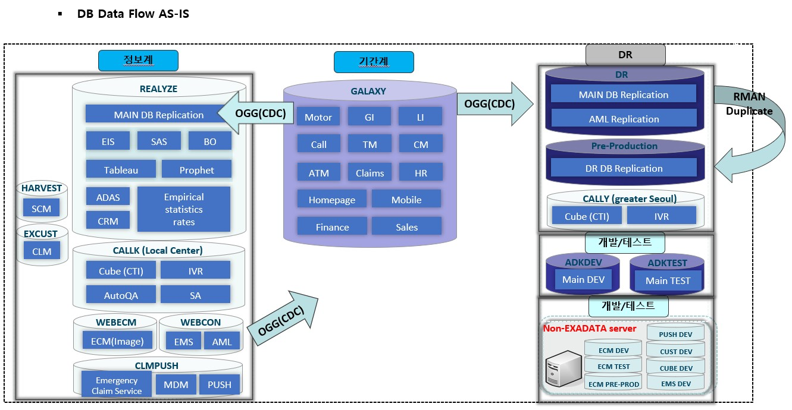
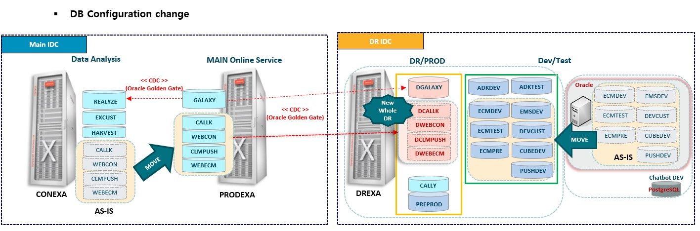
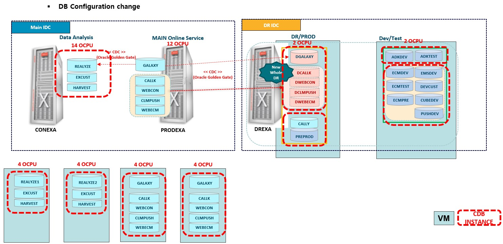
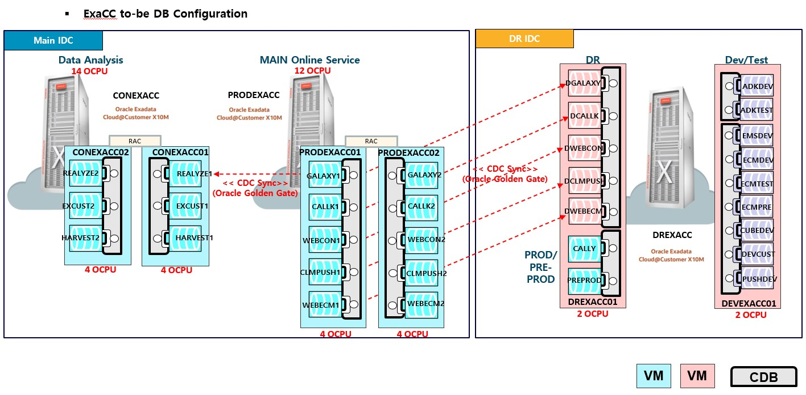

# Exadata Cloud@Customer X10M 전환

[전체 목록으로 돌아가기](README.md)

| 항목 | 내용 |
| --- | --- |
| 기간 | 2024.08 ~ 2025.01 |
| 역할 | PM / Main DBA |
| 전체 대상 | 기간계·정보계·DR·개발을 포함한 Oracle 25개 DB |
| 기존 환경 | Exadata X6/X5, 업무별 독립 DB |
| 전환 환경 | Exadata Cloud@Customer X10M, Oracle 19.23, CDB/PDB |

Oracle 25개 DB 전체의 전환과 안정화를 담당했다. 이관 방식과 작업 순서를 정하고, Oracle 버전 변경과 Non-CDB→CDB/PDB 전환, OGG 동기화, RAC/ASM 가용성, 백업·복구 및 DR 구성을 함께 검토했다.

## 1. 전환에서 먼저 정한 기준

새 장비로 데이터를 옮기는 것만으로 작업을 완료할 수는 없었다. 업무별 DB를 CDB/PDB로 통합하면서 설정 적용 범위가 달라졌고, 전환 이후의 성능과 복구 가능성도 확인해야 했다.

이관 방식은 초기 데이터 구성의 안정성, 반복 실행 가능성, 업그레이드와 PDB 전환 절차, 최종 절체 시간과 원복 가능성을 기준으로 비교했다. DB 작업 외에 애플리케이션, DBLink, 접근제어, OGG, 백업과 모니터링 전환도 작업 범위에 포함했다.

## 2. 이관 방식 선정과 실행

DBLink, Datafile Copy, RMAN Duplicate/Active Duplicate, Hot Backup Clone, RMAN Backup Clone을 테스트했다. 개발계에는 DBLink 기반 이관을 활용할 수 있었지만, 본이행 대상 운영 DB는 데이터 규모와 반복 작업의 안정성을 고려해 RMAN Backup Clone으로 표준화했다.

전체 전환 대상은 25개 DB였고, 이 중 본이행 대상 운영 8개 DB에 같은 표준 절차를 적용했다.

1. 기존 운영 DB의 Full Backup 확보
2. RMAN Backup Clone으로 대상 Non-CDB 선행 구성
3. Oracle 19.23 업그레이드
4. Non-CDB→PDB 전환과 오브젝트 상태 확인
5. OGG로 이후 변경분 동기화
6. 데이터·오브젝트 검증과 최종 절체

DBMS_PDB의 호환성 확인과 noncdb_to_pdb 절차를 테스트에 포함했다. 복구 테스트 중 과거 Archive Log를 요구하며 진행되지 않는 경우에는 성공한 DB와 실패한 DB의 절차를 비교하고, Restore와 Recover를 분리해 재검증했다. 백업 보유 여부와 실제 복구 가능성을 따로 확인했다.

## 3. AS-IS / TO-BE 구성

기존 독립 DB를 CDB/PDB로 통합하고, 기간계·정보계와 DR·개발 환경을 재배치했다. 전환 전후 구성을 AS-IS 1·2·3, TO-BE 1·2·3 순서로 정리했다.

### AS-IS 1 — DB 배치

### AS-IS 2 — Exadata 구성

### AS-IS 3 — 데이터 흐름

### TO-BE 1 — DB 재배치

### TO-BE 2 — VM / CDB 구성

### TO-BE 3 — CDB / PDB와 복제 흐름

그림은 전환 당시 구성 자료이며 현재 운영 상태나 자원 할당을 나타내는 실시간 자료는 아니다.

## 4. CDB/PDB 전환에 따른 파라미터 검토

기존에는 DB별로 적용하던 설정을 새 환경에서는 CDB 공통 항목과 업무별 PDB 항목으로 구분해야 했다. 기술인력의 비교·검토 의견을 확인하고 기존값 유지, 신규값 유지, 별도 조정으로 적용 방향을 정했다.

| 검토 범위 | 확인하고 반영한 내용 |
| --- | --- |
| 옵티마이저 | 동적 샘플링, 인덱스 비용 계산, Adaptive 관련 설정의 기존 운영값 유지 여부 |
| 병렬 실행 | parallel_force_local의 기존 TRUE 유지, DB별 parallel_max_servers·parallel_servers_target 비교 |
| 메모리 | CDB 공통 SGA/PGA와 업무 PDB별 목표·한도 구분, Shared Pool 조정 |
| 접속 수용량 | CDB의 processes와 업무 PDB의 sessions 구분 |
| DB / RAC 프로세스 | db_writer_processes·gcs_server_processes의 기존 운영값 유지 여부 |
| 파일·복구 영역 | 다수 PDB 구성을 고려한 db_files, 복구 영역 크기 검토 |
| OGG | CDB 공통 streams_pool_size를 OGG 기술인력과 함께 검토 |

업무 PDB의 optimizer_dynamic_sampling은 2→0, optimizer_index_caching은 0→40, optimizer_index_cost_adj는 100→50, optimizer_adaptive_reporting_only는 FALSE→TRUE로 기존 운영값을 유지하도록 정리했다. 후속 설정 비교에서 운영 8개 PDB의 반영 상태를 확인했다.

메모리·접속 수용량·복구 영역은 통합 환경에 맞춰 별도로 조정했다. 적용값과 변경 DDL을 CDB/PDB별로 정리했으며, 설정값이 일치하는 것과 SQL 성능이 유지되는 것은 별도 검증으로 관리했다.

## 5. OGG 동기화와 운영 예외

초기 데이터는 백업으로 먼저 구성하고, 이후 변경분을 OGG로 동기화했다. 절체 시점에는 남은 변경분과 트랜잭션 상태를 확인하고 원본 변경을 통제했다. Sequence는 일반 DML과 구분해 대상 값이 원본보다 뒤처지지 않는지 확인했다.

이 과정에서 다음 예외를 처리했다.

| 문제 | 확인과 조치 |
| --- | --- |
| 업무 솔루션이 실행 중 자동 생성하는 테이블 | 오브젝트 생성·소멸 방식을 확인하고 개별 이관 대상으로 분리 |
| 원본에서 직접 수행한 DDL/TRUNCATE 미추출 | DDLOPTIONS를 확인하고 IGNOREAPPLOPS 제거 후 재기동·재이행·모니터링 |
| Replicat에서 대상 오브젝트 부재 오류 | 원본 존재 여부와 업무 오브젝트 여부 확인. 원본에도 없는 일시 오브젝트로 확인한 경우에만 선택적으로 skiptrans 처리 |

## 6. 성능·정합성·가용성·복구 검증

### 성능

SPA 사용을 검토했지만 라이선스 조건과 예상 수행기간이 일정에 맞지 않아 대표 SQL을 직접 비교하는 방식을 선택했다. AWR/MaxGauge에서 CPU·Elapsed 영향도가 높은 SQL을 선정하고, 기존·신규 환경의 Bind 값과 타입, 실행 조건을 맞춰 반복 수행했다.

실행계획, 수행시간, CPU·I/O, Smart Scan/Offload 여부를 비교했다. 테스트에서는 약 81초→2.6초, 250초→0.59초로 개선된 SQL과 약 8.8초→19.3초로 느려진 SQL을 함께 확인했다. 운영 부하가 없는 일부 SQL의 비교 결과였으므로 전체 운영 성능으로 일반화하지 않고, 전환 후 모니터링과 튜닝으로 이어갔다.

별도 전문인력이 수행한 SQL 튜닝 36건은 대상 선정, 작업 조율, 결과 검토와 운영 반영 판단을 맡았다.

### 정합성

- DBA_OBJECTS의 소유자·이름·유형·상태를 비교해 누락과 차이를 확인했다.
- OGG 생성 오브젝트, INVALID→VALID 변화, 시스템 생성 인덱스명 변경 등은 정상적인 전환 차이인지 확인했다.
- 주요 업무 테이블은 같은 검증 SQL로 데이터 건수를 비교했다. 업무 중요도와 절체 시간을 고려해 검증 대상을 정했다.

### 가용성·복구

RAC 노드, 네트워크, Clusterware와 ASM의 장애 조건을 만들어 복구 동작을 검증했다. DR·개발 Single Node 환경은 구조에 맞춰 별도 검증 범위를 정했다.

데이터파일 손실 상황에서 RMAN Restore/Recover와 PDB Open을 확인하고, NetBackup SBT 기반의 Control File·Datafile·Archive 복구도 테스트했다. TDE Wallet 등 복구에 필요한 구성요소를 점검했다. TDE 적용과 Wallet 관련 기술 작업은 수행사가 진행했으며, 나는 해당 작업 내용을 검토했다.

## 7. 절체·원복·DR

본이행에서는 DB와 연계 시스템의 100개 이상 세부 작업을 관리했다. DB 작업 후에도 업무 검증과 연계 서비스 확인이 끝날 때까지 전체 전환 상태를 확인했다.

신규 DB에서 업무가 시작된 뒤 원복해야 하는 경우에 대비해 신규→기존 방향 Reverse OGG를 준비했다. 신규 DB에서 발생한 변경분과 기존 DB의 정합성을 확인할 수 있도록 원복 절차에 포함했다.

신규 DR 완성 전에는 기존 DR을 활용할 수 있도록 임시 복제 요구사항을 정리했다. 이후 신규 DR은 운영 백업으로 초기 구성하고 OGG 동기화, 데이터 검증과 DR 전환 테스트를 진행했다. Go-Live 전 Redo Log와 Control File의 다중화 구성도 다시 확인하고 보완했다.

## 8. 전환 후 문제와 판단

| 상황 | 판단과 대응 |
| --- | --- |
| 병렬 실행 과정에서 진단 Trace 발생 | ORA 오류와 Client 영향 여부, 패치 적용 위험을 검토해 모니터링과 운영 이력 인계로 관리 |
| OGG 관련 SCN 미갱신으로 Archive 삭제 제한 | Oracle SR의 패치 의견과 삭제 우회방안, 추가 변경 위험을 비교 |
| DB 기동 실패와 ASM 메시지 동시 관찰 | 시간상 함께 발생한 사실만으로 원인을 단정하지 않고 SR·설정을 대조. SPFILE을 ASM에 재구성 |

## 결과

Oracle 25개 DB 전체의 ExaCC 전환을 완료했다. 본이행 대상 운영 DB의 이관 절차를 표준화하고, 성능·정합성·가용성·복구 검증과 절체·원복·DR 구성을 함께 관리했다. 전환 후 백업과 모니터링, 접근제어와 DBLink, OGG까지 확인하며 안정화를 진행했다.

[전체 목록으로 돌아가기](README.md)
